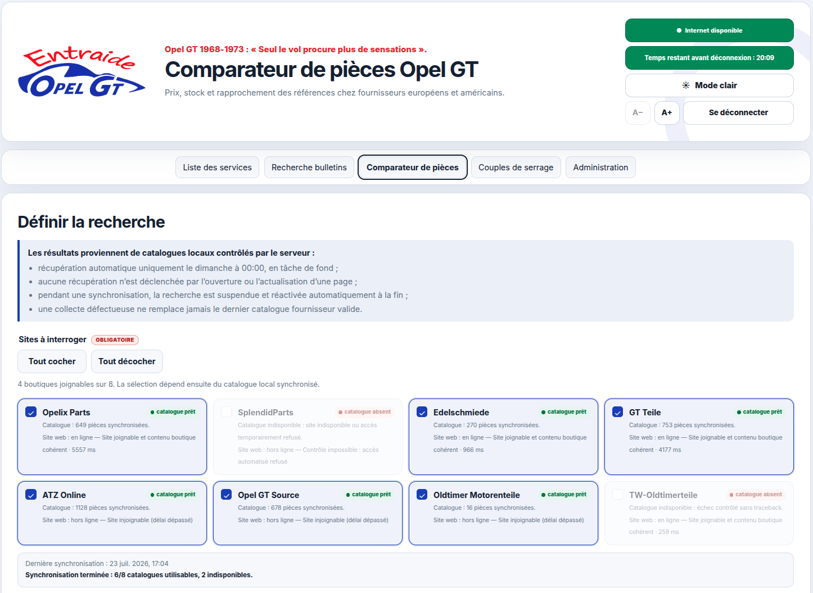

# Portail Entraide Opel GT

**Version 1.1.16 — Linux serveur**

Portail web auto-hébergé réunissant dans une interface commune les principaux outils techniques de l’Entraide Opel GT : recherche dans les bulletins, comparaison de pièces, couples de serrage avec localisation sur vues éclatées, fiche d’intervention et fiche d’inventaire.

Le portail est conçu pour fonctionner en permanence sur un Raspberry Pi ou un petit serveur Debian/Ubuntu. Il s’installe sans Docker, démarre automatiquement avec `systemd`, conserve ses données localement et n’ouvre aucun navigateur sur la machine hôte.

## Sommaire

- [Aperçu](#aperçu)
- [Services inclus](#services-inclus)
- [Matériel et système](#matériel-et-système)
- [Installation](#installation)
- [Cloudflare Tunnel](#cloudflare-tunnel-facultatif)
- [Commandes de `run_server.sh`](#commandes-de-run_serversh)
- [Configuration](#configuration)
- [Mises à jour automatiques](#mises-à-jour-automatiques)
- [Sécurité et confidentialité](#sécurité-et-confidentialité)
- [Sauvegarde et restauration](#sauvegarde-et-restauration)
- [Développement et validation](#développement-et-validation)
- [Publication sur GitHub](#publication-sur-github)
- [Licences](#licences)

## Aperçu

Toutes les captures ci-dessous correspondent à l’interface actuelle du bundle. Les anciennes captures ont été supprimées du dépôt.

### Connexion des membres


### Connexion administrateur


### Liste des services


### Recherche dans les bulletins


### Comparateur de pièces



### Couples de serrage


### Administration


L’interface est responsive et partage sur toutes les pages :

- un mode clair/sombre mémorisé dans le navigateur ;
- une taille de police ajustable et persistante ;
- un indicateur de connectivité calculé côté serveur ;
- un compte à rebours avant expiration de la session ;
- une navigation homogène entre les services et l’administration.

## Services inclus

### Recherche dans les bulletins

- authentification avec le compte membre du site du club ;
- récupération incrémentale des PDF après la connexion ;
- OCR français et anglais avec Tesseract lorsque le PDF ne contient pas de texte exploitable ;
- index local SQLite FTS5 ;
- recherche plein texte avec filtres par année et numéro de bulletin ;
- consultation des PDF locaux ;
- poursuite de la récupération et de l’indexation côté serveur lorsque le navigateur est fermé.

Les identifiants du site membre ne sont ni enregistrés sur disque ni écrits dans les journaux.

### Comparateur de pièces

Le comparateur travaille sur des catalogues locaux historisés. Les boutiques ne sont pas interrogées à chaque recherche utilisateur.

Fournisseurs pris en charge :

- Opelix Parts ;
- SplendidParts ;
- Edelschmiede ;
- GT Teile ;
- ATZ Online ;
- Opel GT Source ;
- Oldtimer Motorenteile ;
- TW-Oldtimerteile.

Fonctions principales :

- recherche multilingue avec normalisation des termes ;
- comparaison des prix et disponibilités ;
- historique des catalogues et indication des variations de prix ;
- filtres, tri, mémorisation des préférences et export CSV ;
- contrôle de cohérence avant remplacement d’un catalogue valide ;
- coordonnées des fournisseurs intégrées à la page.

Pour TW-Oldtimerteile, le scraper compte les catégories Opel GT, exclut la catégorie « J’en ai besoin, je le veux ! », parcourt uniquement les listes et leurs paginations, et n’ouvre pas les fiches individuelles.

La récupération Splendid Parts réutilise une session de boutique persistante et temporise les requêtes afin de ne pas confondre une protection anti-rafale avec une indisponibilité. La couche de contrôle de disponibilité ne contourne aucune restriction `robots.txt` : elle signale une limitation de l’automatisation sans présenter la boutique comme hors ligne.

Les fournisseurs cochés par défaut sont configurables avec `pieces.scraping.default_enabled_sites` :

```json
{
  "pieces": {
    "scraping": {
      "default_enabled_sites": [
        "opelix_parts",
        "splendid_parts",
        "edelschmiede",
        "pro_gt",
        "atz_online",
        "opel_gt_source",
        "oldtimer_motorenteile",
        "tw_oldtimerteile"
      ]
    }
  }
}
```

Retirer un identifiant de cette liste laisse le fournisseur disponible, mais décoché à l’ouverture du comparateur. La clé `disabled_sites` permet de désactiver complètement un fournisseur.

### Couples de serrage

- 61 valeurs issues du tableur embarqué ;
- filtrage par section et présence dans une vue ;
- correspondance bidirectionnelle entre la liste et les repères des vues éclatées ;
- repères colorés par catégorie et mise en évidence du repère sélectionné ;
- volet « Pièces et couples » redimensionnable ou masquable ;
- téléchargement du PDF des couples, du fichier Excel et du PDF français de visserie ;
- conversion rappelée dans l’interface : `m·kg = N·m ÷ 9,80665`.

Les vues éclatées embarquées ne sont pas considérées comme exhaustives : de nouvelles vues peuvent être ajoutées au référentiel.

### Fiche d’intervention

PDF A4 recto/verso à compléter, avec choix du véhicule 1900, 1100 ou GT/J, préparation de l’intervention, pièces utilisées, serrages appliqués et contrôles.

### Fiche d’inventaire

PDF A4 recto/verso de préparation du véhicule, des documents, de l’outillage, des pièces de rechange et du chargement avant déplacement.

### Administration

- édition contrôlée de `/etc/portail-entraide-opel-gt/config.json` ;
- éditeur JSON avec coloration syntaxique, numéros de ligne, ligne courante, parenthèses correspondantes et ascenseurs horizontal/vertical ;
- contrôle du serveur par socket Unix privilégié limité à une liste d’actions autorisées ;
- consultation des tâches de fond et des journaux ;
- état général et statistiques sous forme de badges colorés ;
- graphique interactif de la RAM et de chaque cœur CPU détecté dans `/proc/cpuinfo` et `/proc/stat` ;
- fréquence de rafraîchissement du graphique réglable de 1 à 30 secondes.

## Détection de la connexion Internet

L’indicateur commun aux pages est calculé côté serveur, et non à partir du seul état `navigator.onLine` du navigateur. Le contrôle combine :

- connexions TCP vers plusieurs destinations indépendantes ;
- résolution DNS de plusieurs domaines ;
- requêtes HTTPS légères ;
- `ping` ICMP lorsque la commande est disponible.

Une seule méthode réussie suffit à confirmer la connexion. Plusieurs échecs successifs sont nécessaires avant d’afficher un état hors ligne, et une courte période de grâce évite les faux négatifs provoqués par un délai DNS ou réseau transitoire.

## Matériel et système

### Minimum fonctionnel

- Linux 64 bits : Raspberry Pi OS, Debian ou Ubuntu Server ;
- architecture ARM64/AArch64 ou x86-64 ;
- processeur double cœur ;
- 4 Gio de RAM ;
- 16 Gio de stockage disponible ;
- accès Internet pour l’installation, l’authentification et les synchronisations.

### Configuration recommandée

- Raspberry Pi 5 avec 8 Gio de RAM et refroidissement actif ;
- SSD USB 3 ou NVMe de 64 Gio minimum plutôt qu’une carte microSD ;
- alimentation stable ;
- connexion Ethernet ;
- sauvegarde périodique avec `run_server.sh backup`.

Pour une indexation OCR plus rapide ou plusieurs utilisateurs simultanés, un mini-PC x86-64 avec quatre cœurs, 8 à 16 Gio de RAM et un SSD est préférable.

## Installation

```bash
unzip portail-entraide-opelgt-1.1.16.zip
cd portail-entraide-opelgt
chmod +x run_server.sh
sudo ./run_server.sh install
```

L’installation suit huit grandes étapes :

1. vérification de Linux, de l’architecture et des options d’accès ;
2. préparation des paquets système ;
3. création du compte système non privilégié `opelgt` ;
4. installation des fichiers applicatifs ;
5. création des environnements Python et installation des dépendances verrouillées ;
6. installation de la configuration et des unités `systemd` ;
7. initialisation des données et des tâches de fond ;
8. définition du mot de passe administrateur et affichage des adresses d’accès.

La création des environnements Python peut prendre plusieurs minutes sur un Raspberry Pi.

Le nom du répertoire extrait et du dépôt public est `portail-entraide-opelgt`. Les chemins système installés sous `/opt`, `/etc` et `/var/lib` conservent le nom `portail-entraide-opel-gt` afin de préserver la compatibilité des installations existantes.

## Cloudflare Tunnel facultatif

Pendant `install`, le script peut installer `cloudflared` et enregistrer le tunnel comme service `systemd`. Le jeton se récupère dans le tableau de bord Cloudflare :

```text
Networking → Tunnels → tunnel concerné → Overview → Add a replica → Linux
```

Le jeton correspond à la longue chaîne commençant généralement par `eyJ` dans la commande `cloudflared service install`. Il est saisi de manière masquée.

Le service `cloudflared` :

- démarre automatiquement après chaque redémarrage de la machine ;
- maintient une connexion sortante vers Cloudflare ;
- ne nécessite aucune redirection de port sur le routeur.

La route publiée doit pointer vers :

```text
http://127.0.0.1:8080
```

Le DNS public doit être un CNAME proxifié vers le tunnel concerné :

```text
<UUID-DU-TUNNEL>.cfargotunnel.com
```

Un tunnel peut apparaître « sain » alors que le DNS du sous-domaine pointe vers un autre tunnel. En cas d’erreur Cloudflare 1033, vérifier en priorité la cible CNAME et l’UUID du tunnel utilisé par `cloudflared`.

## Commandes de `run_server.sh`

Chaque commande affiche un en-tête avec le nom du bundle, la version, l’auteur et l’action exécutée.

| Commande | Rôle |
|---|---|
| `sudo ./run_server.sh install` | Installe ou met à niveau le portail en conservant la configuration et les données existantes. |
| `sudo ./run_server.sh start` | Démarre les trois services applicatifs. |
| `sudo ./run_server.sh stop` | Arrête les services applicatifs. |
| `sudo ./run_server.sh restart` | Redémarre les services applicatifs. |
| `sudo ./run_server.sh status` | Affiche l’état des services, timers et du socket de contrôle. |
| `sudo ./run_server.sh health` | Interroge le point de santé `/api/health`. |
| `sudo ./run_server.sh logs [N]` | Suit les journaux locaux, avec éventuellement un nombre de lignes initiales. |
| `sudo ./run_server.sh set-admin-password` | Redéfinit le mot de passe administrateur et invalide les anciennes sessions. |
| `sudo ./run_server.sh retry-ocr` | Remet en file les PDF non indexés. |
| `sudo ./run_server.sh migrate` | Importe explicitement les données des anciens bundles. |
| `sudo ./run_server.sh backup [--output PATH]` | Sauvegarde les données, la configuration et les secrets. |
| `sudo ./run_server.sh restore ARCHIVE` | Restaure transactionnellement une sauvegarde complète. |
| `sudo ./run_server.sh cleanup` | Nettoie les fichiers temporaires et les anciens travaux. |
| `sudo ./run_server.sh apply-config` | Valide la configuration, actualise les timers puis redémarre le portail. |
| `sudo ./run_server.sh uninstall` | Désinstalle l’application en conservant configuration et données. |
| `sudo ./run_server.sh uninstall --purge` | Supprime l’application, les données, PDF, index, catalogues, caches, journaux, sauvegardes et le compte système. |

`system-update-execute` est une commande interne réservée à l’unité `systemd` de maintenance.

## Configuration

Fichier principal :

```text
/etc/portail-entraide-opel-gt/config.json
```

Secrets :

```text
/etc/portail-entraide-opel-gt/secrets.json
```

Données persistantes :

```text
/var/lib/portail-entraide-opel-gt/
```

Après une modification manuelle ou depuis l’administration :

```bash
sudo /opt/portail-entraide-opel-gt/run_server.sh apply-config
```

Sections principales :

- `server` : adresse d’écoute, port, URL publique et proxies de confiance ;
- `sessions` : durée avant déconnexion ;
- `authentication` : URLs du site membre, délais et limites de tentatives ;
- `admin` : activation, identifiant et taille des journaux ;
- `storage` : répertoire des données ;
- `bulletins` : OCR, réseau et taille maximale des PDF ;
- `pieces.scraping` : concurrence, limites réseau, fournisseurs désactivés et fournisseurs cochés par défaut ;
- `pieces.catalog_validation` : seuils de validation d’un nouveau catalogue ;
- `maintenance` : fuseau, calendrier des catalogues, mises à jour système et nettoyage.

Un exemple complet est fourni dans `config.example.json`. Les secrets sont séparés dans `secrets.json` et ne doivent jamais être commités.

## Mises à jour automatiques

### Catalogues fournisseurs

Par défaut : lundi, mercredi et vendredi à 02:00, fuseau `Europe/Paris`.

```text
portail-entraide-opel-gt-catalog-update.timer
```

Une installation vierge met également en file une première récupération lorsqu’aucun catalogue exploitable n’est présent.

### Paquets système

Par défaut : mercredi à 00:00, puis redémarrage de la machine.

```json
{
  "maintenance": {
    "weekly_package_update_enabled": true,
    "weekly_package_update_day": "Wednesday",
    "weekly_package_update_time": "00:00"
  }
}
```

Le jour est écrit en anglais, de `Monday` à `Sunday`, et l’heure au format `HH:MM`. La planification est régénérée avec `apply-config`.

### Nettoyage

Le nettoyage quotidien est exécuté vers 03:30. Il supprime les fichiers temporaires et états obsolètes sans toucher aux catalogues valides ni aux PDF utiles.

## Sécurité et confidentialité

- services exécutés avec le compte système non privilégié `opelgt` ;
- configuration et secrets lisibles uniquement par `root` et le groupe de service ;
- mot de passe administrateur haché avec Argon2 ;
- politique de mot de passe : 16 caractères minimum, minuscule, majuscule, chiffre et caractère spécial ;
- cookies de session signés, durée configurable et révocation à la déconnexion ;
- protection CSRF sur les opérations d’écriture ;
- limitation des tentatives de connexion membre et administrateur ;
- accès HTTP membre limité au réseau local par défaut ;
- HTTPS requis depuis Internet ;
- en-têtes CSP, anti-framing, anti-MIME sniffing et `noindex` ;
- socket Unix privilégié limité aux commandes explicitement autorisées ;
- unités `systemd` renforcées ;
- aucune conservation des identifiants membres ;
- exclusion des secrets, bases, journaux et données d’exécution par `.gitignore`.

Consultez également :

- [`SECURITY.md`](SECURITY.md) ;
- [`PRIVACY.md`](PRIVACY.md) ;
- [`docs/HTTPS.md`](docs/HTTPS.md) ;
- [`SCRAPING_POLICY.md`](SCRAPING_POLICY.md).

## Sauvegarde et restauration

Créer une sauvegarde :

```bash
sudo /opt/portail-entraide-opel-gt/run_server.sh backup
```

Choisir un fichier de destination :

```bash
sudo /opt/portail-entraide-opel-gt/run_server.sh backup --output /chemin/sauvegarde.tar.gz
```

Restaurer :

```bash
sudo /opt/portail-entraide-opel-gt/run_server.sh restore /chemin/sauvegarde.tar.gz
```

Les sauvegardes peuvent contenir des secrets. Elles doivent être conservées hors du dépôt GitHub et protégées par des permissions adaptées.

## Structure du dépôt

```text
portail-entraide-opelgt/
├── .github/                # CI GitHub Actions et Dependabot
├── app/                    # API, authentification, bulletins, catalogues et administration
├── docs/                   # documentation HTTPS et captures du README
├── resources/              # PDF, tableur et vues éclatées embarqués
├── scrapers/               # scrapers autonomes et harmonisés
├── static/                 # interfaces web
├── systemd/                # services, socket et timers
├── tests/                  # tests automatisés
├── config.example.json
├── secrets.example.json
└── run_server.sh
```

## Développement et validation

```bash
python3 -m venv .venv
. .venv/bin/activate
pip install -r requirements-dev.lock
python -W error -m pytest -q
ruff check .
bash -n run_server.sh
```

La CI GitHub vérifie également :

- ShellCheck ;
- la syntaxe JavaScript avec Node.js ;
- les empreintes des dépendances verrouillées ;
- l’absence de secrets, bases et journaux d’exécution.

Les tests couvrent notamment l’authentification, les sessions, la configuration, les jobs, les catalogues, les scrapers, le déploiement, les documents embarqués et les interfaces communes.

## Publication sur GitHub

Le bundle est préparé pour un dépôt public :

- licence du code à la racine ;
- notices des composants tiers ;
- politique de sécurité et de confidentialité ;
- guide de contribution ;
- workflow GitHub Actions ;
- configuration Dependabot ;
- `.gitignore` excluant secrets et données d’exécution ;
- aucun `config.json`, `secrets.json`, fichier `.env`, base, journal ou archive de sauvegarde inclus.

Avant le premier `push`, vérifier localement :

```bash
git status --short
find . -type f \
  \( -name 'config.json' -o -name 'secrets.json' -o -name '.env' \
     -o -name '*.db' -o -name '*.sqlite*' -o -name '*.log' \) -print
```

Initialisation possible :

```bash
git init
git add .
git commit -m "Publication initiale du Portail Entraide Opel GT 1.1.16"
```

Ne publiez jamais un jeton Cloudflare, une sauvegarde, le fichier `/etc/portail-entraide-opel-gt/secrets.json` ni les données de `/var/lib/portail-entraide-opel-gt/`.

## Licences

Le code du portail est distribué sous **GNU AGPL-3.0-only**. Voir [`LICENSE`](LICENSE).

Les principaux composants tiers et leurs licences sont recensés dans [`THIRD_PARTY_NOTICES.md`](THIRD_PARTY_NOTICES.md). PyMuPDF est distribué sous AGPL-3.0 ou licence commerciale Artifex ; la notice embarquée figure dans [`LICENSES/PyMuPDF.txt`](LICENSES/PyMuPDF.txt).

Le nom, le logo, les bulletins, les PDF, les photographies, les marques et les contenus éditoriaux restent la propriété de leurs titulaires respectifs et ne sont pas placés sous AGPL par la licence du code.

## Auteur

Nicolas Lermé — Entraide Opel GT — Copyright 2026.
