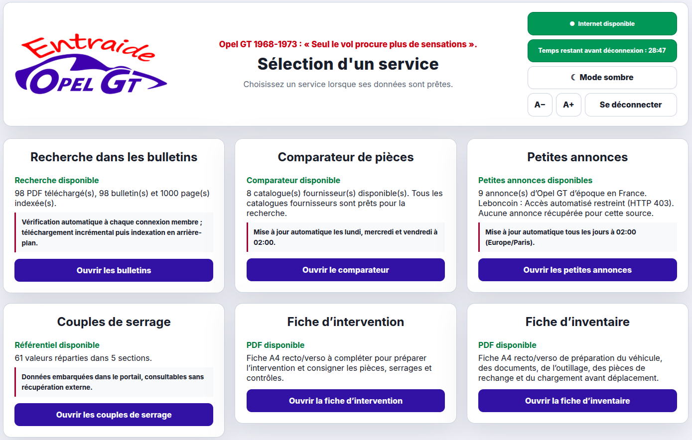
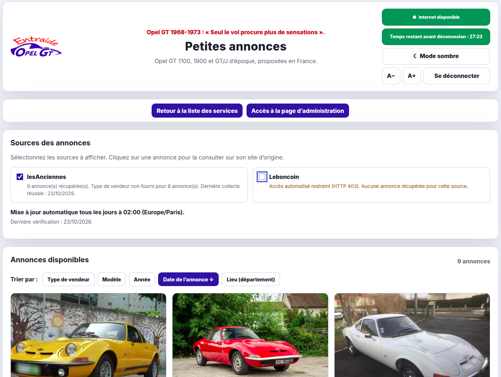

# Portail Entraide Opel GT

**Version 1.1.38 — Linux serveur**

**Langages et formats**


**Application et collecte**


**Données, documents et OCR**


**Hébergement et notifications**


**Développement et validation**


Portail web auto-hébergé réunissant six services dans une interface commune : recherche dans les bulletins, comparaison de pièces, petites annonces d’Opel GT d’époque en France, couples de serrage avec localisation sur vues éclatées, fiche d’intervention et fiche d’inventaire.

Le portail est conçu pour fonctionner en permanence sur un Raspberry Pi ou un petit serveur Debian/Ubuntu. Il s’installe sans Docker, démarre automatiquement avec `systemd`, conserve ses données localement et n’ouvre aucun navigateur sur la machine hôte.

## Sommaire

- [Aperçu](#aperçu)
- [Services inclus](#services-inclus)
- [Matériel et système](#matériel-et-système)
- [Installation](#installation)
- [Notifications ntfy (facultatif)](#notifications-ntfy-facultatif)
- [Cloudflare Tunnel (facultatif)](#cloudflare-tunnel-facultatif)
- [Commandes de `run_server.sh`](#commandes-de-run_serversh)
- [Configuration](#configuration)
- [Mises à jour automatiques](#mises-à-jour-automatiques)
- [Sécurité et confidentialité](#sécurité-et-confidentialité)
- [Sauvegarde et restauration](#sauvegarde-et-restauration)
- [Structure du dépôt](#structure-du-dépôt)
- [Développement et validation](#développement-et-validation)
- [Licences](#licences)
- [Auteur](#auteur)

## Aperçu

### Connexion des membres


### Page de connexion administrateur


### Liste des services



### Recherche dans les bulletins


### Comparateur de pièces


### Petites annonces



### Couples de serrage


### Administration


L’interface est responsive et partage sur toutes les pages :

- un logo PNG transparent, sans rectangle blanc en mode sombre ;
- des pages de connexion membre et administrateur harmonisées ;
- sur chaque connexion, un bandeau avec le logo Opel de 1964 sur fond blanc, le logo du club et un QR code de même hauteur, adaptés à la largeur disponible. Le QR code est calculé localement et reprend l’adresse du portail ouverte dans le navigateur : `/` pour les membres, `/admin` pour l’administration, sans paramètres ni identifiants. Le rendu est recalculé après redimensionnement ou zoom pour conserver des modules nets. Un clic agrandit le QR code sans quitter le formulaire ;
- le numéro de version en pied de toutes les pages, y compris les connexions, avec une séparation horizontale et un lien vers le dépôt GitHub accompagné de son icône locale ;
- un mode clair/sombre mémorisé dans le navigateur ;
- une taille de police ajustable et persistante ;
- un indicateur de connectivité calculé côté serveur ;
- un compte à rebours avant expiration de la session ;
- une navigation homogène entre les services et l’administration.

Les quatre pages de service (Bulletins, Comparateur de pièces, Petites annonces et Couples de serrage) utilisent le même pied de page : 46 badges correspondant aux technologies listées ci-dessus, une séparation, le copyright et « Fait avec amour ❤️ ». Les badges SVG sont fournis localement dans le bundle et les styles sont centralisés dans `static/common/footer.css`.

Les sept pages web, les deux formulaires de connexion, les onglets d’administration et la visionneuse PDF sont adaptés aux petits écrans et au texte agrandi. Les tableaux, vues éclatées, éditeurs et navigations peuvent conserver un défilement local pour rester utilisables sans élargir toute la page.

## Services inclus

### Recherche dans les bulletins

- authentification avec le compte membre du site du club ;
- première récupération des PDF en arrière-plan dès `sudo ./run_server.sh install`, sans connexion au portail ;
- mises à jour incrémentales et indexation chaque dimanche à 02:00, heure de Paris ;
- OCR français et anglais avec Tesseract lorsque le PDF ne contient pas de texte exploitable ;
- index local SQLite FTS5 ;
- recherche plein texte avec filtres par année et numéro de bulletin ;
- consultation des PDF locaux dans une visionneuse intégrée PDF.js, avec défilement continu à la molette ou au doigt, zoom, ouverture à la page trouvée, surlignage configurable des passages trouvés (jaune par défaut) et boutons d’occurrence précédente/suivante ; les scripts, polices et décodeurs sont embarqués pour ordinateur et smartphone ;
- poursuite de la récupération et de l’indexation côté serveur lorsque le navigateur est fermé.

L’installation demande le compte membre Entraide Opel GT utilisé pour les collectes automatiques, avec saisie masquée du mot de passe. Ce compte est enregistré dans la section `bulletins` du fichier de secrets protégé, lisible par `root` et le groupe du service ; il n’est jamais renvoyé au navigateur ni écrit dans les journaux. Lors d’une nouvelle installation, les identifiants existants peuvent être conservés ou remplacés. Les connexions des utilisateurs au portail restent distinctes et ne déclenchent plus de collecte.

La visionneuse fait défiler toutes les pages du bulletin à la molette ou par glissement sur écran tactile. Depuis un résultat de recherche, les passages trouvés sont surlignés, en jaune par défaut ; les boutons ↑ et ↓ passent à l’occurrence précédente ou suivante dans le bulletin, avec retour à la dernière ou à la première occurrence. Le repérage fonctionne avec le texte natif et avec les scans : les positions OCR des pages concernées sont calculées à la première consultation, puis conservées dans le cache local. Les PDF d’origine et leur index ne sont pas modifiés. Les boutons de navigation deviennent utilisables dès qu’une première occurrence est repérée, pendant le traitement des autres pages. La couleur se règle dans « Administration → Configuration → Surlignage dans les bulletins PDF » : choisissez la couleur, puis cliquez sur « Enregistrer » et « Appliquer et redémarrer ». Le réglage JSON correspondant est `bulletins.viewer.highlight_color`, par exemple `"#ffff00"`. Dans les pages essentiellement scannées, le repérage suit les mots de l’image visible plutôt qu’une éventuelle couche texte invisible décalée. Les anciennes positions de surlignage sont recalculées automatiquement lors de leur prochaine consultation.

### Comparateur de pièces

Le comparateur travaille sur des catalogues locaux historisés. Les boutiques ne sont pas interrogées à chaque recherche utilisateur.

Fournisseurs pris en charge :

- Opelix Parts ;
- SplendidParts ;
- Edelschmiede ;
- GT Teile ;
- ATZ Online ;
- Opel GT Source ;
- Oldtimer Motorenteile ;
- TW-Oldtimerteile.

Fonctions principales :

- recherche multilingue avec normalisation des termes ;
- comparaison des prix et disponibilités ;
- historique des catalogues et indication des variations de prix ;
- filtres, tri, mémorisation des préférences et export CSV ;
- contrôle de cohérence avant remplacement d’un catalogue valide ;
- coordonnées des fournisseurs intégrées à la page.

Pour TW-Oldtimerteile, le scraper compte les catégories Opel GT, exclut la catégorie « J’en ai besoin, je le veux ! », parcourt uniquement les listes et leurs paginations, et n’ouvre pas les fiches individuelles.

La récupération Splendid Parts réutilise une session de boutique persistante et temporise les requêtes afin de ne pas confondre une protection anti-rafale avec une indisponibilité. La couche de contrôle de disponibilité ne contourne aucune restriction `robots.txt` : elle signale une limitation de l’automatisation sans présenter la boutique comme hors ligne.

Les fournisseurs cochés par défaut sont configurables avec `pieces.scraping.default_enabled_sites` :

```json
{
  "pieces": {
    "scraping": {
      "default_enabled_sites": [
        "opelix_parts",
        "splendid_parts",
        "edelschmiede",
        "pro_gt",
        "atz_online",
        "opel_gt_source",
        "oldtimer_motorenteile",
        "tw_oldtimerteile"
      ]
    }
  }
}
```

Retirer un identifiant de cette liste laisse le fournisseur disponible, mais décoché à l’ouverture du comparateur. La clé `disabled_sites` permet de désactiver complètement un fournisseur.

Les huit catalogues suivent la progression réelle de la collecte et des traductions. Les traductions en cache sont réutilisées ; si le traducteur est indisponible, les désignations originales peuvent être conservées pour les nouveaux noms. GT Teile traite les traductions par lots après la collecte, avec une durée totale limitée à 30 minutes ou au délai global configuré s’il est inférieur. Les contrôles d’intégrité précèdent toujours la publication ; un échec conserve le dernier catalogue valide.

### Petites annonces

Ce service recense les voitures proposées en France, par des particuliers et professionnels : Opel GT 1100, GT 1900 et GT/J d’époque. Les GT modernes, annonces de pièces et véhicules localisés à l’étranger sont exclus. Une GT d’époque dont la cylindrée n’est pas fournie reste libellée « Modèle non précisé ».

| Source | Périmètre | Collecte |
|---|---|---|
| [lesAnciennes](https://www.lesanciennes.com/annonces/voiture-collection/opel-gt/) | Annonces automobiles Opel GT, filtrées sur les véhicules d’époque situés en France | Lecture des données publiques des pages de résultats et de leur pagination. |
| [Leboncoin](https://www.leboncoin.fr/recherche?category=2&text=opel%20gt) | Catégorie voitures, recherche Opel GT sur toute la France | Client Python [etienne-hd/lbc](https://github.com/etienne-hd/lbc), version 1.1.7 verrouillée, profil HTTP explicite, recherche commune particuliers/professionnels et pagination avec curseur. Les refus et résultats partiels restent signalés. |
| [Classic Number](https://www.classicnumber.com/opel-gt-collection-m-58-2648.html) | Opel GT d’époque ; seuls les véhicules situés en France sont conservés | Résultats publics et fiches des véhicules français pour la date originale et le lieu. |
| [Classic Trader](https://www.classic-trader.com/fr/voitures/recherche/opel/gt) | Opel GT ; filtrage strict sur le pays du véhicule et les modèles d’époque | Données structurées publiques Astro des résultats ; aucune consultation de profil vendeur. |

Les sources cochées par défaut sont configurables avec `annonces.default_enabled_sources`, dans le fichier de configuration JSON ou dans l’onglet « Configuration » de l’administration :

```json
{
  "annonces": {
    "default_enabled_sources": [
      "lesanciennes",
      "leboncoin",
      "classicnumber",
      "classictrader"
    ]
  }
}
```

Les quatre sources sont cochées par défaut. Retirer un identifiant de cette liste laisse la source disponible, mais décochée à l’ouverture de la page ; une liste vide `[]` ne coche aucune source. Après modification, enregistrez la configuration puis utilisez « Appliquer et redémarrer ». Le bouton « Réinitialiser les filtres » rétablit cette sélection par défaut. Les cases filtrent uniquement l’affichage des annonces déjà enregistrées ; elles ne modifient ni les sources collectées ni la mise à jour automatique quotidienne à 2 h, heure de Paris.

En bas de page, une carte OpenStreetMap rassemble et localise les petites annonces affichées, en suivant les filtres sélectionnés. Chaque repère reprend la couleur de la source et le numéro de l’annonce ; un clic affiche son récapitulatif (prix, modèle, année, lieu, date) et un lien vers l’annonce d’origine. Les positions correspondent au centre des communes, et les annonces dont le lieu n’a pas pu être résolu sont signalées sous la carte.

### Couples de serrage

- 61 valeurs issues du tableur embarqué ;
- filtrage par section et présence dans une vue ;
- correspondance bidirectionnelle entre la liste et les repères des vues éclatées ;
- trois vues nommées selon leur emplacement : suspension avant et direction (1), suspension avant et freins (2), direction (3) ;
- repères colorés par catégorie et mise en évidence du repère sélectionné ;
- volet « Pièces et couples » redimensionnable ou masquable ;
- téléchargement du PDF des couples, du fichier Excel et du PDF français de visserie ;
- conversion rappelée dans l’interface : `m·kg = N·m ÷ 9,80665`.

Les 61 valeurs restent inchangées. Les trois schémas disponibles ne couvrent pas toutes les pièces, notamment le moteur et la suspension arrière. Le bloc « Utilisation » décrit les correspondances et les commandes. La poignée placée sous les deux volets ajuste simultanément leur hauteur, à la souris ou au clavier ; ce réglage est mémorisé dans le navigateur. « Vue affichée » et « Pièces et couples » utilisent la même taille de titre.

### Fiche d’intervention

PDF A4 recto/verso à compléter, avec choix du véhicule 1900, 1100 ou GT/J, préparation de l’intervention, pièces utilisées, serrages appliqués et contrôles.

### Fiche d’inventaire

PDF A4 recto/verso de préparation du véhicule, des documents, de l’outillage, des pièces de rechange et du chargement avant déplacement.

### Administration

- édition contrôlée de `/etc/portail-entraide-opel-gt/config.json` ;
- éditeur JSON avec coloration syntaxique, numéros de ligne, ligne courante, parenthèses correspondantes et ascenseurs horizontal/vertical ;
- contrôle du serveur par socket Unix privilégié limité à une liste d’actions autorisées ;
- consultation des tâches de fond et des journaux ;
- état général avec badges bleus uniformes et statistiques avec couleurs sémantiques, pourcentages pertinents et drapeaux de pays ;
- graphique interactif de la RAM et de chaque cœur CPU détecté dans `/proc/cpuinfo` et `/proc/stat` ;
- fréquence de rafraîchissement du graphique réglable de 1 à 30 secondes ;
- onglet **Notifications** pour activer ntfy, régler ses identifiants et l’intervalle entre les envois.

## Matériel et système

### Minimum fonctionnel

- Linux 64 bits : Raspberry Pi OS, Debian ou Ubuntu Server ;
- architecture ARM64/AArch64 ou x86-64 ;
- processeur double cœur ;
- 4 Gio de RAM ;
- 16 Gio de stockage disponible ;
- accès Internet pour l’installation, l’authentification et les synchronisations.

### Configuration recommandée

- Raspberry Pi 5 avec 8 Gio de RAM et refroidissement actif ;
- SSD USB 3 ou NVMe de 64 Gio minimum plutôt qu’une carte microSD ;
- alimentation stable ;
- connexion Ethernet ;
- sauvegarde périodique avec `run_server.sh backup`.

Pour une indexation OCR plus rapide ou plusieurs utilisateurs simultanés, un mini-PC x86-64 avec quatre cœurs, 8 à 16 Gio de RAM et un SSD est préférable.

## Installation

```bash
unzip portail-entraide-opelgt-1.1.38.zip
cd portail-entraide-opelgt
chmod +x run_server.sh
sudo ./run_server.sh install
```

L’installation suit huit grandes étapes :

1. vérification de Linux et de l’architecture, puis saisie des réglages ntfy, du compte membre pour les bulletins et des options d’accès ;
2. préparation des paquets système ;
3. création du compte système non privilégié `opelgt` ;
4. installation des fichiers applicatifs ;
5. création des environnements Python et installation des dépendances verrouillées ;
6. installation de la configuration et des unités `systemd` ;
7. initialisation des données et des tâches de fond ;
8. définition du mot de passe administrateur et affichage des adresses d’accès.

La création des environnements Python peut prendre plusieurs minutes sur un Raspberry Pi.

À l’étape 7, les services lancent les collectes initiales en arrière-plan, y compris celle des bulletins. La fin du script n’attend pas la fin des téléchargements ni des OCR. Le terminal et le navigateur peuvent rester fermés ensuite ; les tâches se poursuivent côté serveur. Une mise à niveau conserve les PDF et les index déjà présents.

Lors de la copie vers `/opt`, les dates de modification situées dans le futur sont ramenées à l’heure courante du serveur pour éviter l’avertissement d’horodatage de `tar`. Les dates antérieures et les fichiers du répertoire source sont conservés.

Le nom du répertoire extrait et du dépôt public est `portail-entraide-opelgt`. Les chemins système installés sous `/opt`, `/etc` et `/var/lib` conservent le nom `portail-entraide-opel-gt` afin de préserver la compatibilité des installations existantes.

## Notifications ntfy (facultatif)

L’activation est proposée au début de `sudo ./run_server.sh install`. Les réglages restent modifiables dans **Administration → Notifications**, sans redémarrage.

| Réglage | Valeur à renseigner |
|---|---|
| Serveur | `https://ntfy.sh` par défaut, ou votre serveur ntfy HTTPS. |
| Sujet | Un nom long et imprévisible de votre choix, identique à l’abonnement créé dans l’application ntfy du téléphone. |
| Authentification | **Aucune** pour un sujet public ; sinon le jeton autorisé à publier, ou l’utilisateur et son mot de passe. |
| Intervalle entre deux envois | De **1 à 365 jours** ; `1` signifie au maximum un message toutes les 24 heures. |

Un sujet public ne nécessite pas de compte et n’est pas privé. Pour en contrôler l’accès, utilisez un sujet protégé avec les identifiants du serveur ntfy. Sur le téléphone, installez l’application ntfy, abonnez-vous au même serveur et au même sujet, puis autorisez ses notifications.

Le moniteur contrôle environ chaque minute la connexion Internet, le portail, les workers, le tunnel Cloudflare géré par le bundle et les erreurs des catalogues et des sources d’annonces. Il enregistre les incidents et leurs rétablissements, puis regroupe les événements en attente selon l’intervalle choisi. La file et la date du dernier envoi réussi persistent après redémarrage. Pendant une coupure Internet, les événements attendent le retour de la connexion ; une panne complète du serveur nécessite une surveillance externe.

Les champs de jeton et de mot de passe restent masqués et vides à l’ouverture. Pour conserver un secret, laissez son champ vide sans changer de mode d’authentification. Changer de mode retire l’ancien identifiant ; désactiver ntfy efface ses identifiants. Ils sont stockés dans le fichier de secrets protégé et ne sont jamais renvoyés au navigateur.

Les abonnements de la page Petites annonces ajoutent les nouveautés et baisses de favoris au même envoi regroupé. Ils sont désactivés par défaut et concernent les changements observés après l’abonnement. Le résumé attend la fin de la collecte, fusionne les changements en attente et n’est acquitté qu’après un envoi réussi. Sans changement, aucun résumé d’annonces n’est ajouté.

L’installation met un message de test en file. Pour en ajouter un manuellement :

```bash
sudo ./run_server.sh ntfy-test
```

Les tests respectent eux aussi la limite d’envoi. Un échec reste en attente. La désinstallation avec `--purge` arrête le moniteur et supprime ses réglages, ses secrets et sa file ; elle ne retire pas les messages déjà remis à ntfy ni les sauvegardes exportées.

Documentation : [ntfy — publication et authentification](https://docs.ntfy.sh/publish/).

## Cloudflare Tunnel (facultatif)

L’installateur peut publier le portail avec `cloudflared`, sans redirection de port sur le routeur. Dans le tableau de bord Cloudflare, ouvrez **Networking → Tunnels → votre tunnel → Overview → Add a replica → Linux**. Copiez le jeton de la commande `cloudflared service install` et saisissez-le dans l’installateur ; la saisie est masquée.

Configurez la route du tunnel vers `http://127.0.0.1:8080` et le CNAME proxifié du sous-domaine vers `<UUID-DU-TUNNEL>.cfargotunnel.com`. En cas d’erreur **1033**, vérifiez que cet UUID correspond au tunnel utilisé par `cloudflared`.

Le connecteur démarre avec la machine et utilise HTTP/2. Un contrôle indépendant chaque minute sonde le portail local et le connecteur ; après trois échecs consécutifs, il redémarre le service concerné, en respectant les arrêts volontaires. Lors d’une mise à niveau depuis une installation sans cette surveillance, répondez **oui** à l’option Cloudflare et saisissez le jeton existant.

La désinstallation arrête la surveillance puis le connecteur géré par le portail. Avec `--purge`, elle arrête et désactive également `cloudflared.service` pour les anciennes installations et signale explicitement tout échec. Le paquet et la définition globale du service restent installés.

## Commandes de `run_server.sh`

Chaque commande affiche un en-tête avec le nom du bundle, la version, l’auteur et l’action exécutée.

| Commande | Rôle |
|---|---|
| `sudo ./run_server.sh install` | Installe ou met à niveau le portail en conservant la configuration et les données existantes. |
| `sudo ./run_server.sh start` | Démarre les trois services applicatifs. |
| `sudo ./run_server.sh stop` | Arrête les services applicatifs. |
| `sudo ./run_server.sh restart` | Redémarre les services applicatifs. |
| `sudo ./run_server.sh status` | Affiche l’état des services, timers et du socket de contrôle. |
| `sudo ./run_server.sh health` | Interroge le point de santé `/api/health`. |
| `sudo ./run_server.sh ntfy-test` | Met un test ntfy en file, soumis à la limite d’envoi configurée. |
| `sudo ./run_server.sh logs [N]` | Suit les journaux locaux, avec éventuellement un nombre de lignes initiales. |
| `sudo ./run_server.sh set-admin-password` | Redéfinit le mot de passe administrateur et invalide les anciennes sessions. |
| `sudo ./run_server.sh retry-ocr` | Remet en file les PDF non indexés. |
| `sudo ./run_server.sh migrate` | Importe explicitement les données des anciens bundles. |
| `sudo ./run_server.sh backup [--output PATH]` | Sauvegarde les données, la configuration et les secrets. |
| `sudo ./run_server.sh restore ARCHIVE` | Restaure transactionnellement une sauvegarde complète. |
| `sudo ./run_server.sh cleanup` | Nettoie les fichiers temporaires et les anciens travaux. |
| `sudo ./run_server.sh apply-config` | Valide la configuration, actualise les timers puis redémarre le portail. |
| `sudo ./run_server.sh uninstall` | Désinstalle l’application en conservant configuration et données. |
| `sudo ./run_server.sh uninstall --purge` | Arrête et désactive aussi `cloudflared`, puis supprime l’application, les données, PDF, index, catalogues, caches, journaux, sauvegardes et le compte système. |

`system-update-execute` est une commande interne réservée à l’unité `systemd` de maintenance.

## Configuration

Fichier principal :

```text
/etc/portail-entraide-opel-gt/config.json
```

Secrets :

```text
/etc/portail-entraide-opel-gt/secrets.json
```

Données persistantes :

```text
/var/lib/portail-entraide-opel-gt/
```

Après une modification de la configuration principale, manuelle ou depuis l’administration :

```bash
sudo /opt/portail-entraide-opel-gt/run_server.sh apply-config
```

Sections principales :

- `server` : adresse d’écoute, port, URL publique et proxies de confiance ;
- `sessions` : durée avant déconnexion ;
- `authentication` : URLs du site membre, délais et limites de tentatives ;
- `admin` : activation, identifiant et taille des journaux ;
- `storage` : répertoire des données ;
- `bulletins` : OCR, réseau et taille maximale des PDF ;
- `pieces.scraping` : concurrence, limites réseau, fournisseurs désactivés et fournisseurs cochés par défaut ;
- `pieces.catalog_validation` : seuils de validation d’un nouveau catalogue ;
- `maintenance` : fuseau, calendrier des catalogues, mises à jour système et nettoyage.

Un exemple complet est fourni dans `config.example.json`. Les secrets sont séparés dans `secrets.json` et ne doivent jamais être commités.

### Collecte Leboncoin

Le client [etienne-hd/lbc](https://github.com/etienne-hd/lbc), version 1.1.7 verrouillée, reste utilisé. Une seule recherche réunit particuliers et professionnels, sans ouvrir leurs profils ; elle demande jusqu’à 100 résultats par page. L’élargissement automatique des résultats est désactivé et le total de la recherche est demandé. Le filtrage des modèles d’époque en France reste appliqué aux annonces reçues.

Le profil initial est `safari170`. Les identifiants anonymes du client et ses cookies sont conservés par profil dans le fichier privé `annonces/.leboncoin-session.json` du répertoire de données, en mode `0600`. Le profil qui a réellement réussi est repris aux collectes suivantes. Un cookie valide évite une nouvelle initialisation de la page d’accueil. Ces données ne contiennent pas de compte membre et sont supprimées avec les données lors d’une désinstallation avec `--purge` ; elles ne doivent pas être publiées.

En cas de refus 403 avant réception de la première page, le collecteur attend dix secondes puis essaie **un seul** profil de secours. `annonces.leboncoin.fallback_profiles` contient par défaut `["chrome146", "firefox147"]` ; au plus deux profils peuvent être configurés, ou `[]` pour désactiver ce recours. Chaque profil refusé est mis en pause pendant deux heures, y compris entre redémarrages. Le SDK ne lance pas ses réessais récursifs. Un refus en cours de pagination conserve les observations et ne change pas de session au milieu d’un curseur.

`annonces.leboncoin.impersonate` permet de choisir le profil initial parmi ceux pris en charge par `curl-cffi`. Les profils Android Chrome 131 et `chrome_android`, signalés comme problématiques dans le dépôt du client, restent refusés. `annonces.leboncoin.request_interval_seconds` espace les pages de deux secondes par défaut, avec une valeur autorisée de 2 à 30 secondes.

Le curseur fourni par le serveur est transmis à la page suivante et le décalage suit la taille réellement reçue. Les doublons et compteurs incohérents sont contrôlés ; une interruption conserve les annonces récupérées et les anciennes annonces non revérifiées. Seule une collecte complète actualise la date de dernière réussite. Les bornes de 200 pages et trois minutes restent en place.

Leboncoin décide de l’acceptation de chaque requête : cette reprise ne garantit pas la suppression de tous les refus DataDome. Les refus restent indiqués. Lorsque la collecte est indisponible, la page « Liste des services » affiche un accès direct à la recherche Leboncoin ; cette recherche reste également accessible dans les sources de la page « Petites annonces ».

### Détection de la connexion Internet

L’indicateur commun aux pages est calculé côté serveur, et non à partir du seul état `navigator.onLine` du navigateur. Le contrôle combine :

- connexions TCP vers plusieurs destinations indépendantes ;
- résolution DNS de plusieurs domaines ;
- requêtes HTTPS légères ;
- `ping` ICMP lorsque la commande est disponible.

Une seule méthode réussie suffit à confirmer la connexion. Plusieurs échecs successifs sont nécessaires avant d’afficher un état hors ligne, et une courte période de grâce évite les faux négatifs provoqués par un délai DNS ou réseau transitoire.

## Mises à jour automatiques

### Bulletins

La première récupération est lancée par `sudo ./run_server.sh install`. Ensuite, la vérification des nouveautés a lieu **chaque dimanche à 02:00**, fuseau **Europe/Paris**, par les unités :

```text
portail-entraide-opel-gt-bulletins-update.service
portail-entraide-opel-gt-bulletins-update.timer
```

Le service utilise le compte membre saisi pendant l’installation. Les PDF absents ou modifiés sont téléchargés ; seuls les documents nouveaux, modifiés, non indexés ou nécessitant une nouvelle signature OCR sont mis en file d’indexation. Les autres PDF et leurs index sont réutilisés. Le worker OCR existant traite cette file indépendamment du navigateur.

Lors du passage à l’heure d’été, où 02:00 n’existe pas, la collecte du dimanche est rattrapée à 03:00. Le passage à l’heure d’hiver ne provoque pas de seconde collecte une fois l’échéance couverte.

Une nouvelle exécution de l’installation ne relance pas la collecte si une synchronisation réussie a déjà couvert l’échéance hebdomadaire. Un verrou empêche les collectes concurrentes. Le timer persistant rattrape une échéance manquée après un arrêt du serveur. Les connexions au portail ne modifient pas ce calendrier. L’état du traitement reste visible dans la liste des services et sur la page Bulletins.

```bash
systemctl list-timers portail-entraide-opel-gt-bulletins-update.timer
sudo journalctl -u portail-entraide-opel-gt-bulletins-update.service -n 100
```

Si l’authentification échoue, relancez `sudo ./run_server.sh install` pour remplacer les identifiants. La désinstallation arrête la collecte et désactive le timer. Avec `--purge`, les identifiants du compte de collecte, les PDF et leurs index sont supprimés ; les sauvegardes exportées restent à protéger séparément.

### Catalogues fournisseurs

Par défaut : lundi, mercredi et vendredi à 02:00, fuseau `Europe/Paris`.

```text
portail-entraide-opel-gt-catalog-update.timer
```

Une installation vierge met également en file une première récupération lorsqu’aucun catalogue exploitable n’est présent.

### Petites annonces

Tous les jours à **02:00**, fuseau **Europe/Paris**, par les unités :

```text
portail-entraide-opel-gt-annonces-update.timer
portail-entraide-opel-gt-annonces-update.service
```

Le timer est installé et activé par `sudo ./run_server.sh install`, y compris lors d’une mise à niveau. Cette commande lance également une collecte en arrière-plan, sans attendre sa fin. Les réglages de l’horaire des catalogues n’affectent pas celui des annonces. `Persistent=true` rattrape une échéance manquée après l’arrêt du serveur. Un verrou commun empêche deux collectes simultanées. La durée du service est limitée à quinze minutes et chaque source possède ses limites de requêtes et de durée.

Pour consulter la planification et les derniers résultats :

```bash
systemctl list-timers portail-entraide-opel-gt-annonces-update.timer
sudo journalctl -u portail-entraide-opel-gt-annonces-update.service -n 100
```

La désinstallation arrête la collecte éventuelle, désactive le timer et retire ses deux unités. Sans `--purge`, les annonces collectées sont conservées avec les autres données ; avec `--purge`, elles sont supprimées.

Les préférences par compte, numéros, historique des prix et cache des communes sont stockés dans le même répertoire de données des annonces : une mise à niveau les conserve et `uninstall --purge` les supprime. L’actualisation manuelle utilise le service systemd existant et le canal de contrôle installé ; en exécution autonome sans systemd, un processus séparé utilise le même verrou.

### Paquets système

Par défaut : mercredi à 00:00, puis redémarrage de la machine.

```json
{
  "maintenance": {
    "weekly_package_update_enabled": true,
    "weekly_package_update_day": "Wednesday",
    "weekly_package_update_time": "00:00"
  }
}
```

Le jour est écrit en anglais, de `Monday` à `Sunday`, et l’heure au format `HH:MM`. La planification est régénérée avec `apply-config`.

### Nettoyage

Le nettoyage quotidien est exécuté vers 03:30. Il supprime les fichiers temporaires et états obsolètes sans toucher aux catalogues valides ni aux PDF utiles.

## Sécurité et confidentialité

- services exécutés avec le compte système non privilégié `opelgt` ;
- configuration et secrets lisibles uniquement par `root` et le groupe de service ;
- mot de passe administrateur haché avec Argon2 ;
- politique de mot de passe : 16 caractères minimum, minuscule, majuscule, chiffre et caractère spécial ;
- cookies de session signés, durée configurable et révocation à la déconnexion ;
- protection CSRF sur les opérations d’écriture ;
- limitation des tentatives de connexion membre et administrateur ;
- accès HTTP membre limité au réseau local par défaut ;
- HTTPS requis depuis Internet ;
- en-têtes CSP, anti-framing, anti-MIME sniffing et `noindex` ;
- socket Unix privilégié limité aux commandes explicitement autorisées ;
- unités `systemd` renforcées ;
- aucune conservation des identifiants membres ;
- exclusion des secrets, bases, journaux et données d’exécution par `.gitignore`.

Consultez également :

- [`SECURITY.md`](SECURITY.md) ;
- [`PRIVACY.md`](PRIVACY.md) ;
- [`docs/HTTPS.md`](docs/HTTPS.md) ;
- [`SCRAPING_POLICY.md`](SCRAPING_POLICY.md).

## Sauvegarde et restauration

Créer une sauvegarde :

```bash
sudo /opt/portail-entraide-opel-gt/run_server.sh backup
```

Choisir un fichier de destination :

```bash
sudo /opt/portail-entraide-opel-gt/run_server.sh backup --output /chemin/sauvegarde.tar.gz
```

Restaurer :

```bash
sudo /opt/portail-entraide-opel-gt/run_server.sh restore /chemin/sauvegarde.tar.gz
```

Les sauvegardes peuvent contenir des secrets. Elles doivent être conservées hors du dépôt GitHub et protégées par des permissions adaptées.

## Structure du dépôt

```text
portail-entraide-opelgt/
├── .github/                # CI GitHub Actions et Dependabot
├── app/                    # API, authentification, bulletins, catalogues, annonces et administration
├── docs/                   # documentation HTTPS et captures du README
├── resources/              # PDF, tableur et vues éclatées embarqués
├── scrapers/               # scrapers autonomes et harmonisés
├── static/                 # interfaces web
├── systemd/                # services, socket et timers
├── tests/                  # tests automatisés
├── config.example.json
├── secrets.example.json
└── run_server.sh
```

## Développement et validation

```bash
python3 -m venv .venv
. .venv/bin/activate
pip install -r requirements-dev.lock
python -W error -m pytest -q
ruff check .
bash -n run_server.sh
```

La CI GitHub vérifie également :

- ShellCheck ;
- la syntaxe JavaScript avec Node.js ;
- les empreintes des dépendances verrouillées ;
- l’absence de secrets, bases et journaux d’exécution.

Les tests couvrent notamment l’authentification, les sessions, la configuration, les jobs, les catalogues, les scrapers, les annonces (modèles, France, pagination, tris, échecs et verrouillage), le déploiement, les documents embarqués et les interfaces communes. Les validations de cette version et les limites des essais réels sont détaillées dans [`VALIDATION.md`](VALIDATION.md).

## Licences

Le code du portail est distribué sous **GNU AGPL-3.0-only**. Voir [`LICENSE`](LICENSE).

Les principaux composants tiers et leurs licences sont recensés dans [`THIRD_PARTY_NOTICES.md`](THIRD_PARTY_NOTICES.md). PyMuPDF est distribué sous AGPL-3.0 ou licence commerciale Artifex ; la notice embarquée figure dans [`LICENSES/PyMuPDF.txt`](LICENSES/PyMuPDF.txt).

Le nom, le logo, les bulletins, les PDF, les photographies, les marques et les contenus éditoriaux restent la propriété de leurs titulaires respectifs et ne sont pas placés sous AGPL par la licence du code.

## Auteur

Nicolas Lermé — Entraide Opel GT — Copyright 2026 — Fabriqué avec amour ❤️
